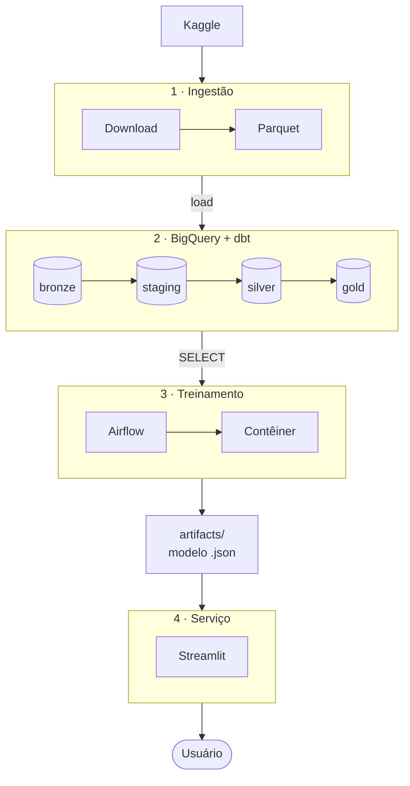
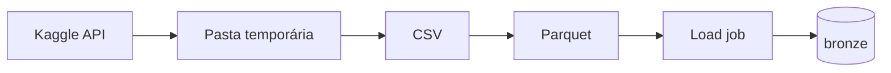
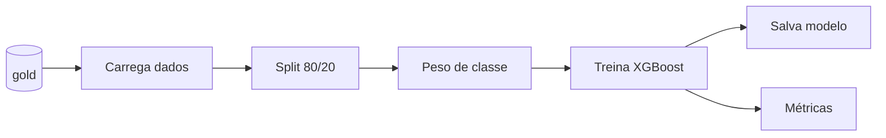
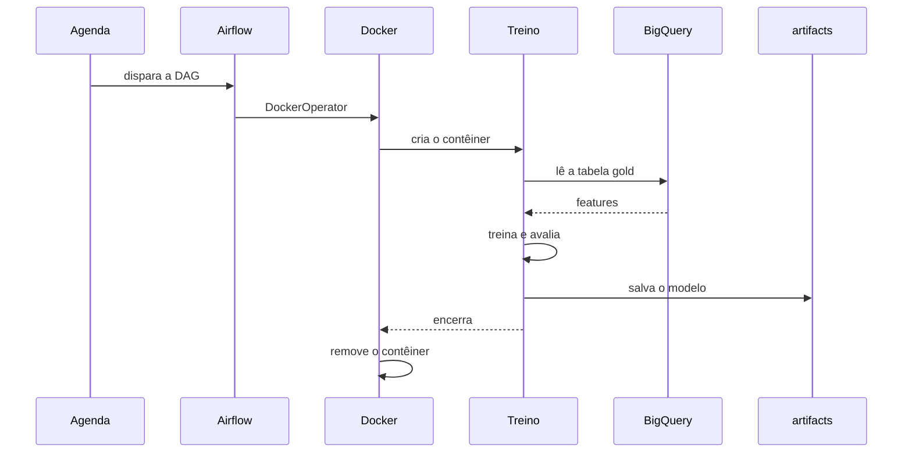

# 📦 Olist Satisfaction Classifier · MLOps em Produção


Plataforma de dados e Machine Learning de ponta a ponta que estima o **risco de insatisfação de clientes de e-commerce** (dados públicos da Olist). O projeto cobre todo o ciclo: **ingestão** a partir do Kaggle, **Data Warehouse em camadas** (bronze, silver e gold) no BigQuery transformado com **dbt**, **treinamento** de um modelo XGBoost orquestrado por **Apache Airflow** em contêineres **Docker**, e **inferência online** em uma aplicação **Streamlit**.

🔗 **App no ar:** [olist-satisfaction-classifier.streamlit.app](https://olist-satisfaction-class.streamlit.app/)

> **Só tem um minuto?** Veja o [diagrama de ponta a ponta](#arquitetura) e abra o app.  
> **Quer ver a pesquisa que originou o projeto?** Veja [Origem do projeto](#origem).

## Sumário

- [🎯 Visão geral](#visao-geral)
- [🧱 Arquitetura de ponta a ponta](#arquitetura)
- [📁 Estrutura do repositório](#estrutura)
- [📥 Ingestão (Bronze)](#ingestao)
- [🔄 Transformação (dbt)](#transformacao)
- [🧠 Treinamento (ML)](#treinamento)
- [📈 Desempenho do modelo](#desempenho)
- [🐳 Orquestração e contêineres](#orquestracao)
- [🌉 Contrato de artefatos](#artefatos)
- [📊 Aplicação (Streamlit)](#aplicacao)
- [🧭 Decisões de arquitetura](#decisoes)
- [🔑 Configuração](#configuracao)
- [🚧 Limitações conhecidas](#limitacoes)
- [📚 Origem do projeto](#origem)

---

<a id="visao-geral"></a>

## 🎯 Visão geral

**Problema de negócio:** é possível saber se um cliente ficará insatisfeito com a compra antes que ele registre uma reclamação?

**Solução:** um classificador binário (XGBoost) treinado sobre os pedidos reais da Olist (2016 a 2018). Classes: **Insatisfeito** (nota 1 a 3) e **Satisfeito** (nota 4 e 5). O modelo usa **11 variáveis** de logística, pagamento, anúncio e geografia, disponíveis logo após a entrega do pedido.

**Valor para o negócio:** o modelo não substitui o atendimento, ele o prioriza. Depois da entrega e antes da avaliação, a equipe pode abordar primeiro os pedidos de maior risco (mensagem de acompanhamento, cupom).

**Como o sistema está organizado:** quatro estágios desacoplados, cada um com uma responsabilidade e um ponto de entrega bem definido.

| # | Estágio | Responsabilidade | Tecnologia | Entrega |
|---|---|---|---|---|
| 1 | **Ingestão** | Baixar o dataset e carregá-lo cru no Data Warehouse | Kaggle API · pandas · Parquet | Dataset `olist_bronze` no BigQuery |
| 2 | **Transformação** | Limpar, modelar e gerar as features | dbt · BigQuery SQL | Tabela `olist_gold.ft_satisfacao_cliente` |
| 3 | **Treinamento** | Treinar e avaliar o modelo em ambiente reprodutível | Airflow · Docker · XGBoost | `artifacts/modelo_olist_xgb_baseline.json` |
| 4 | **Serviço** | Servir previsões e explicações aos usuários | Streamlit Community Cloud | Aplicação web interativa |

---

<a id="arquitetura"></a>

## 🧱 Arquitetura de ponta a ponta



O sistema segue dois princípios:

- **Arquitetura em camadas (medallion):** o dado bruto nunca é alterado; cada camada seguinte adiciona qualidade e significado de negócio, até chegar a uma tabela pronta para ML.
- **Desacoplamento entre treino e serviço:** a parte pesada roda em lote e de forma invisível (a "fábrica"); a parte que o usuário enxerga fica leve e disponível 24/7 (a "loja"). A única ligação entre elas é um arquivo de modelo.

---

<a id="estrutura"></a>

## 📁 Estrutura do repositório

```text
.
├── src/
│   └── ingestion_bronze.py          # Estágio 1: Kaggle → Parquet → BigQuery (bronze)
├── olist_transform/                 # Estágio 2: projeto dbt
│   ├── dbt_project.yml              # Materialização e schema de cada camada
│   ├── macros/
│   │   └── generate_schema_name.sql # Força o nome exato dos schemas no BigQuery
│   └── models/
│       ├── staging/                 # Views: tipagem e padronização (+ testes e sources)
│       ├── silver/                  # Tabelas: dimensões e fatos deduplicados
│       └── gold/
│           └── ft_satisfacao_cliente.sql   # Tabela de features + target
├── ml/                              # Estágio 3: código de Machine Learning
│   ├── config.py                    # Features, target e parâmetros de treino
│   ├── data_loader.py               # Leitura da camada gold no BigQuery
│   ├── train.py                     # Treino e exportação do modelo
│   └── evaluate.py                  # Métricas e utilitários SHAP
├── dags/
│   └── olist_ml_dag.py              # DAG do Airflow (DockerOperator)
├── artifacts/
│   └── modelo_olist_xgb_baseline.json   # Contrato Airflow ↔ Streamlit
├── streamlit/
│   └── app.py                       # Estágio 4: aplicação de inferência
├── docs/
│   ├── Historico-Analitico.md       # Fase 1: a pesquisa que originou o projeto
│   └── exemplo_site_github.mp4      # Demonstração do app
├── logs/                            # Logs do dbt
├── Dockerfile                       # Imagem do pipeline de treino
├── docker-compose.yaml              # Serviço do Airflow
├── requirements.txt                 # Dependências Python
├── .env-exemplo                     # Modelo das variáveis de ambiente
├── .dockerignore
├── .gitignore
└── README.md
```

---

<a id="ingestao"></a>

## 📥 Ingestão (Bronze)

**Arquivo:** `src/ingestion_bronze.py` · **Destino:** dataset `olist_bronze` no BigQuery

A ingestão baixa o dataset diretamente do Kaggle e o entrega ao BigQuery **sem deixar arquivos no disco**. Todo o processamento acontece em um diretório temporário que é descartado ao final.



| Etapa | O que acontece |
|---|---|
| **Autenticação** | `KaggleApi.authenticate()` usa o token configurado no ambiente. |
| **Diretório virtual** | `tempfile.TemporaryDirectory()` cria uma pasta efêmera; ao sair do bloco `with`, tudo é apagado automaticamente. |
| **Download** | `dataset_download_files("olistbr/brazilian-ecommerce", unzip=True)` baixa e descompacta o dataset direto na pasta temporária. |
| **CSV → Parquet** | Cada CSV é lido com `dtype=str` (nenhuma inferência de tipo na ingestão) e gravado como Parquet via `pyarrow`. |
| **Carga no BigQuery** | `load_table_from_file` com `SourceFormat.PARQUET` e `WRITE_TRUNCATE`: a tabela de destino é substituída a cada execução. |
| **Nomeação** | O nome da tabela vem do arquivo, sem `.csv` e sem o sufixo `_dataset` (ex.: `olist_orders_dataset.csv` → `olist_bronze.olist_orders`). |

**Resultado:** 9 tabelas **brutas**, todas em texto, fiéis à origem: `olist_customers`, `olist_geolocation`, `olist_order_items`, `olist_order_payments`, `olist_order_reviews`, `olist_orders`, `olist_products`, `olist_sellers` e `product_category_name_translation`. A tipagem é responsabilidade da camada seguinte.

---

<a id="transformacao"></a>

## 🔄 Transformação (dbt)

**Projeto:** `olist_transform/` · **Engine:** BigQuery · **Padrão:** ELT em três camadas

As transformações rodam **dentro do BigQuery**, escritas em SQL e versionadas com dbt. As dependências entre modelos são declaradas com `ref()`, o que dá ao dbt o grafo de linhagem completo.

| Camada | Schema | Materialização | Papel |
|---|---|---|---|
| **Staging** | `olist_staging` | `view` | Converte tipos (`SAFE_CAST`), padroniza texto (`TRIM`, `UPPER`/`LOWER`) e corrige CEPs com `LPAD`. Uma view por tabela bronze. |
| **Silver** | `olist_silver` | `table` | Dimensões e fatos limpos: deduplicação, tratamento de nulos e filtro de pedidos válidos. |
| **Gold** | `olist_gold` | `table` | Tabela analítica final, com as features e o alvo de ML. |

> A macro `generate_schema_name` sobrescreve o comportamento padrão do dbt para que os schemas tenham exatamente os nomes `olist_staging`, `olist_silver` e `olist_gold`, sem prefixos do ambiente.

### Staging (7 views)

`stg_olist_orders` · `stg_olist_customer` · `stg_olist_order_items` · `stg_olist_order_payments` · `stg_olist_order_reviews` · `stg_olist_products` · `stg_olist_sellers`

As origens são declaradas em `_stg_olist__sources.yml` (source `bronze`). Os modelos principais têm **testes de qualidade** em `_stg_olist__models.yml`: `unique` e `not_null` nas chaves de pedidos e clientes, e `not_null` nas chaves dos itens de pedido.

### Silver (7 tabelas)

| Modelo | Tipo | Regra principal |
|---|---|---|
| `fct_orders` | Fato | Mantém apenas pedidos com status `delivered`; uma linha por `order_id`. |
| `fct_order_items` | Fato | Uma linha por (`order_id`, `order_item_id`); nulos de preço e frete viram 0. |
| `fct_reviews` | Fato | Uma avaliação por pedido (a mais recente, por data de resposta). |
| `dim_customers` | Dimensão | Um registro por `customer_id`. |
| `dim_sellers` | Dimensão | Um registro por `seller_id`. |
| `dim_products` | Dimensão | Um registro por `product_id`; nulos tratados (`'outros'` para categoria, 0 para medidas). |
| `dim_payments` | Dimensão | Um registro por (`order_id`, `payment_sequential`); parcelas ausentes viram 1. |

A deduplicação usa `QUALIFY ROW_NUMBER() OVER (PARTITION BY ...) = 1` em todos os modelos.

### Gold: `ft_satisfacao_cliente`

Une pedidos, itens, avaliações, produtos, clientes, vendedores e pagamentos em uma única tabela, com **uma linha por item de pedido**. Descarta linhas sem tempo de entrega, atraso ou tempo de postagem. É a **fonte única de dados do treinamento**.

| Categoria | Feature | Como é calculada |
|---|---|---|
| **Logística** | `tempo_entrega_dias` | Dias entre a compra e a entrega ao cliente. |
| | `dias_atraso` | Dias entre a data estimada e a data real de entrega (negativo = chegou adiantado). |
| | `tempo_postagem_vendedor` | Dias entre a aprovação do pedido e a entrega à transportadora. |
| **Financeira** | `proporcao_frete` | Frete dividido pelo preço do item (`SAFE_DIVIDE`). |
| | `valor_total_pedido` | Soma de produtos e frete do pedido. |
| | `qtd_parcelas` | Maior número de parcelas do pedido (padrão 1). |
| **Produto** | `qtd_fotos` | Fotos do anúncio. |
| | `tamanho_descricao` | Caracteres da descrição do produto. |
| | `volume_produto_cm3` | Comprimento × altura × largura da embalagem. |
| | `qtd_itens_pedido` | Quantidade de itens do pedido. |
| **Geográfica** | `mesma_uf` | 1 se cliente e vendedor estão no mesmo estado, senão 0. |
| **Alvo** | `target_satisfeito` | 1 se `review_score` ≥ 4 (satisfeito), 0 caso contrário (insatisfeito). |

---

<a id="treinamento"></a>

## 🧠 Treinamento (ML)

**Pasta:** `ml/` · **Ponto de entrada:** `python ml/train.py`

O código de ML é dividido em módulos com responsabilidade única:

| Módulo | Responsabilidade |
|---|---|
| `config.py` | Fonte única de configuração: projeto, tabela gold, lista das 11 features, alvo, proporção de teste (20%), semente (42) e métrica de avaliação do XGBoost (`logloss`). Também reserva o espaço de busca de hiperparâmetros (`PARAM_GRID`, `N_ITER`, `N_SPLITS_CV`). |
| `data_loader.py` | Lê a tabela `olist_gold.ft_satisfacao_cliente` do BigQuery e devolve um DataFrame. |
| `train.py` | Orquestra o treino: carrega os dados, separa treino/teste, treina o modelo e exporta o artefato. |
| `evaluate.py` | Imprime o relatório de classificação e o ROC-AUC; traz utilitários SHAP (gráficos global e individual) para análise exploratória. |

### Fluxo do `train.py`



- **Divisão estratificada:** treino e teste mantêm a mesma proporção de satisfeitos e insatisfeitos.
- **Desbalanceamento de classes:** o peso é calculado dinamicamente a cada treino (`scale_pos_weight` = classe 0 ÷ classe 1 no conjunto de treino), sem valor fixo no código. O modelo salvo hoje carrega o valor ≈ 0,30.
- **Modelo baseline:** `XGBClassifier` (objetivo `binary:logistic`) com os hiperparâmetros padrão da biblioteca, 100 árvores, semente fixa e `eval_metric=logloss`.
- **Avaliação:** a cada execução, o relatório de classificação (precisão, recall e F1 por classe) e o ROC-AUC na base de teste são impressos nos logs do contêiner, e portanto visíveis no log da tarefa no Airflow. Os resultados do modelo atual estão em [Desempenho do modelo](#desempenho).

---

<a id="desempenho"></a>

## 📈 Desempenho do modelo

Resultado do modelo baseline na base de teste (20% da tabela gold, **21.870 linhas**), exatamente como impresso pelo `evaluate.py` ao final do treino:

```text
--- Desempenho do Modelo BASE ---
              precision    recall  f1-score   support

         0.0       0.46      0.55      0.50      5070
         1.0       0.86      0.81      0.83     16800

    accuracy                           0.75     21870
   macro avg       0.66      0.68      0.67     21870
weighted avg       0.77      0.75      0.76     21870

ROC-AUC Score: 0.7357
```

| Métrica | Classe 0 (Insatisfeito) | Classe 1 (Satisfeito) |
|---|---|---|
| **Precisão** | 0,46 | 0,86 |
| **Recall** | 0,55 | 0,81 |
| **F1-score** | 0,50 | 0,83 |
| **Suporte (teste)** | 5.070 | 16.800 |

| Métrica global | Valor |
|---|---|
| **ROC-AUC** | **0,7357** |
| **Acurácia** | 0,75 |

**Como interpretar:**
- **Recall de 55% na classe insatisfeito:** o modelo identifica pouco mais da metade dos clientes que deram nota 1 a 3. É a métrica mais relevante para o caso de uso, que é priorizar o atendimento.
- **Precisão de 46%:** cerca de 4 a 5 em cada 10 alertas correspondem a clientes de fato insatisfeitos. Por isso, as ações sugeridas devem ser de baixo custo, já que parte dos alertas será falso alarme.
- **ROC-AUC de 0,74:** o modelo separa os dois perfis de forma consistente e bem acima do acaso (0,50), mas está longe de ser um classificador perfeito.
- **Acurácia deve ser lida com cautela:** a classe satisfeito representa cerca de 77% do teste (16.800 de 21.870). A acurácia sozinha engana em bases desbalanceadas, por isso o foco está no recall e no ROC-AUC da classe minoritária.

---

<a id="orquestracao"></a>

## 🐳 Orquestração e contêineres

### Componentes

| Arquivo | Função |
|---|---|
| **`Dockerfile`** | Imagem do pipeline: `python:3.12-slim`, instala o `requirements.txt` e copia o projeto. O comando padrão é `python ml/train.py`. |
| **`docker-compose.yaml`** | Sobe o Airflow 2.7.2 (`apache/airflow:2.7.2-python3.10`) em modo `standalone`, com a interface na porta `8080`, a pasta `dags/` montada e o socket do Docker (`/var/run/docker.sock`) exposto. |
| **`dags/olist_ml_dag.py`** | Define a DAG `olist_ml_pipeline`, que executa o treino em um contêiner efêmero. |
| **`.dockerignore`** | Mantém fora da imagem o `.env`, a chave `gcp-key.json`, o `.venv` e a pasta `artifacts/`. |

### A DAG `olist_ml_pipeline`

| Parâmetro | Valor |
|---|---|
| **Agendamento** | Semanal, toda segunda-feira às 02:00 (cron `0 2 * * 1`) |
| **Catchup** | Desativado |
| **Tentativas** | 1 nova tentativa, com intervalo de 2 minutos |
| **Tarefa** | `treinar_modelo_baseline` (`DockerOperator`) |
| **Imagem** | `olist-refactor-pipeline:latest` |
| **Contêiner** | Efêmero: `auto_remove=True` o destrói ao terminar |
| **Montagens (bind mounts)** | `artifacts/` (saída do modelo) e `gcp-key.json` (credencial) |
| **Variáveis injetadas** | `GOOGLE_APPLICATION_CREDENTIALS` e `GCP_PROJECT_ID` |

### Ciclo de uma execução



O Airflow não treina nada por conta própria: ele **comanda o Docker do host** (padrão *Docker-out-of-Docker*, via socket) para criar um contêiner irmão. Assim, o ambiente de treino é sempre o mesmo, definido pela imagem, e nenhum estado fica preso no contêiner depois da execução.

---

<a id="artefatos"></a>

## 🌉 Contrato de artefatos

A pasta `artifacts/` é a **ponte** entre a fábrica (Airflow) e a loja (Streamlit).

| Artefato | Escrito por | Lido por | Função |
|---|---|---|---|
| `modelo_olist_xgb_baseline.json` | `ml/train.py` (sobrescrito a cada treino) | `streamlit/app.py` | Modelo XGBoost serializado em JSON, com as 11 features e o `scale_pos_weight` embutidos |

- **Escrita:** o contêiner grava na pasta `artifacts/` do host por meio do bind mount.
- **Publicação:** o `.gitignore` libera os modelos em JSON (`!artifacts/*.json`), então o artefato é versionado junto ao código. O Streamlit Community Cloud serve o app a partir do GitHub, portanto o modelo publicado é o que está no repositório.
- **Validação do contrato:** ao iniciar, o app compara as features salvas dentro do modelo com as que ele próprio espera. Se divergirem, exibe um erro explícito em vez de gerar previsões incorretas. Se o arquivo não existir, orienta a executar o pipeline de treino.

---

<a id="aplicacao"></a>

## 📊 Aplicação (Streamlit)

**Arquivo:** `streamlit/app.py` · **Hospedagem:** Streamlit Community Cloud (via GitHub)

https://github.com/user-attachments/assets/e32f57ec-aaba-4b69-9b82-f5bd2e2470b6

O app é a camada de serviço: **não treina, não acessa o BigQuery e não depende do Airflow**. Ele apenas carrega o modelo de `artifacts/` (subindo um nível a partir da própria pasta, sem caminhos fixos) e o mantém em cache com `st.cache_resource`. A cada ajuste do usuário, ele calcula a previsão em milissegundos.

- **Painel de simulação (barra lateral):** 11 parâmetros organizados em *Logística*, *Pedido* e *Anúncio e produto*, com atualização em tempo real.
- **Cenários prontos:** *Padrão*, *Pedido ideal*, *Entrega atrasada*, *Compra parcelada* e *Anúncio fraco*.
- **Medidor de risco (gauge):** a partir da probabilidade de satisfação, classifica o risco como **Alto** (abaixo de 50%), **Moderado** (50% a 60%) ou **Baixo** (acima de 60%). No risco alto, sugere uma ação preventiva.
- **Aba "Por que essa previsão?":** contribuição de cada variável para aquele pedido, calculada em tempo real com os **valores SHAP nativos do XGBoost** (`pred_contribs`), com destaque para o maior fator de risco e o maior fator de proteção.
- **Aba "Curva de sensibilidade":** varia um parâmetro por vez, mantendo os demais, e mostra como a probabilidade de satisfação responde.
- **Aba "Sobre o projeto":** dicionário das features, orientação de interpretação e limitações.

---

<a id="decisoes"></a>

## 🧭 Decisões de arquitetura

| Decisão | Motivo |
|---|---|
| **ELT dentro do BigQuery** | O dado é transformado onde já está, com SQL versionado e testável via dbt, sem mover dados entre sistemas. |
| **Parquet na ingestão** | Formato colunar, com esquema embutido e carga nativa no BigQuery. |
| **Bronze 100% em texto** | A ingestão não faz inferência de tipos: o dado bruto chega fiel à origem e a tipagem acontece de forma explícita no staging (`SAFE_CAST`). |
| **Diretório temporário** | Nenhum arquivo residual: a pasta é apagada automaticamente, o que simplifica a execução em qualquer ambiente. |
| **`WRITE_TRUNCATE`** | A carga é idempotente: reexecutar a ingestão substitui a tabela em vez de duplicar linhas. |
| **Medallion + dbt** | Separa responsabilidades por camada, documenta a linhagem com `ref()` e valida chaves com testes. |
| **Gold como contrato de dados** | A lista de features em `ml/config.py` espelha as colunas da tabela gold; o treino consome uma única tabela pronta. |
| **Contêiner efêmero** | Ambiente de treino idêntico a cada execução, sem estado persistente e sem sobras. |
| **Artefato como contrato** | Treino e serviço evoluem de forma independente; a validação de features no app detecta incompatibilidades. |
| **Peso de classe dinâmico** | O desbalanceamento é medido no próprio conjunto de treino a cada execução, sem valor fixo no código. |

---

<a id="configuracao"></a>

## 🔑 Configuração

| Item | Onde | Uso |
|---|---|---|
| `KAGGLE_API_TOKEN` | `.env` (modelo em `.env-exemplo`) | Autenticação na Kaggle API durante a ingestão |
| `GCP_PROJECT_ID` | `.env` e variável do contêiner na DAG | Projeto do BigQuery em todos os estágios |
| `gcp-key.json` | Raiz do projeto, montada no contêiner | Credencial de service account do Google Cloud |
| `GOOGLE_APPLICATION_CREDENTIALS` | Variável do contêiner (`/app/gcp-key.json`) | Aponta as bibliotecas do Google para a credencial montada |
| `CAMINHO_PROJETO` | Constante em `dags/olist_ml_dag.py` | Caminho absoluto do projeto no host, usado nos bind mounts |
| Profile `olist_transform` | Configuração do dbt, fora do repositório | Conexão do dbt com o BigQuery |

---

<a id="limitacoes"></a>

## 🚧 Limitações conhecidas

- **Escopo da DAG:** hoje o Airflow orquestra o estágio de **treinamento**. A ingestão (`src/ingestion_bronze.py`) e a transformação (`dbt`) são etapas executadas à parte, ainda fora da DAG.
- **Promoção do modelo:** o modelo treinado vai para o app por meio do versionamento do arquivo JSON no GitHub, ou seja, a publicação depende de um commit.
- **Modelo baseline:** o treino usa os hiperparâmetros padrão do XGBoost. O espaço de busca está definido em `ml/config.py`, mas a otimização ainda não faz parte do pipeline.
- **Granularidade e métricas:** a tabela gold tem uma linha por item de pedido e a divisão treino/teste é aleatória. Itens do mesmo pedido podem cair nos dois conjuntos, o que pode deixar as métricas um pouco otimistas.
- **Uso após a entrega:** tempo de entrega e dias de atraso só existem depois que o pedido chega. O modelo estima o risco depois da entrega e antes da avaliação, não no momento da compra.
- **Probabilidades como índice de risco:** por causa do `scale_pos_weight`, as probabilidades funcionam melhor como índice de risco relativo do que como frequência real.
- **Correlação, não causalidade:** o modelo aprende padrões dos dados de 2016 a 2018 e não mede o efeito de ações de mitigação.

---

<a id="origem"></a>

## 📚 Origem do projeto

Este sistema nasceu de uma pesquisa em análise de dados: logística de entrega por estado, previsão de prazos com BigQuery ML e a primeira versão do classificador de satisfação com XGBoost e SHAP. Foi essa pesquisa que definiu o problema, as variáveis e o algoritmo que hoje rodam em produção.

📜 **Leia a história completa, com metodologia, decisões e resultados, em [`docs/Historico-Analitico.md`](docs/Historico-Analitico.md).**

---

<sub>Dados: [Olist Brazilian E-Commerce Public Dataset](https://www.kaggle.com/datasets/olistbr/brazilian-ecommerce) (Kaggle), pedidos anonimizados realizados no Brasil entre 2016 e 2018.</sub>