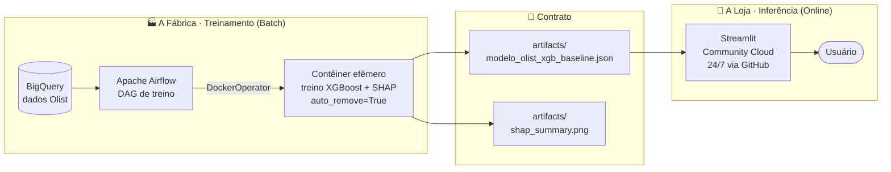

# 📦 Olist Satisfaction Classifier · MLOps em Produção


Sistema de Machine Learning em produção que estima o **risco de insatisfação de clientes de e-commerce** (dados da Olist) com um modelo **XGBoost**, sustentado por uma arquitetura desacoplada: o **treinamento em lote** é orquestrado pelo **Apache Airflow** em contêineres **Docker**, e a **inferência online** é servida por uma aplicação **Streamlit** que consome o modelo treinado por meio de um contrato de artefatos versionado.

🔗 **App no ar:** [olist-satisfaction-classifier.streamlit.app](https://olist-satisfaction-classifier.streamlit.app/)

> **Só tem um minuto?** Veja o [diagrama da arquitetura](#-arquitetura) e abra o app.  
> **Quer reproduzir?** Vá direto para [Como reproduzir](#-como-reproduzir).  
> **Quer ver a pesquisa por trás da engenharia?** Veja [Origem do projeto](#-origem-do-projeto) e o [histórico analítico completo](docs/HISTORICO_ANALITICO.md).

## 🧭 Sumário

- [🎯 Visão geral](#-visão-geral)
- [🏗️ Arquitetura](#️-arquitetura)
- [⚙️ Componentes](#️-componentes)
- [🗂️ Estrutura do repositório](#️-estrutura-do-repositório)
- [🚀 Como reproduzir](#-como-reproduzir)
- [📊 Desempenho do modelo](#-desempenho-do-modelo)
- [🖥️ Aplicação (Streamlit)](#️-aplicação-streamlit)
- [🔐 Segurança e governança](#-segurança-e-governança)
- [⚠️ Limitações](#️-limitações)
- [📚 Origem do projeto](#-origem-do-projeto)

---

## 🎯 Visão geral

**Problema de negócio:** é possível saber se um cliente ficará insatisfeito com a compra antes que ele registre uma reclamação?

**Solução:** um classificador binário (XGBoost) treinado sobre mais de 100 mil pedidos reais da Olist (2016 a 2018). Classes: **Insatisfeito** (nota 1 a 3) e **Satisfeito** (nota 4 e 5). O modelo usa 11 variáveis de logística, pagamento, anúncio e geografia, disponíveis logo após a entrega do pedido.

**Valor para o negócio:** o modelo não substitui o atendimento, ele o prioriza. Depois da entrega e antes da avaliação, a equipe pode abordar primeiro os pedidos de maior risco (mensagem de acompanhamento, cupom). Como a precisão é moderada, as ações devem ser de baixo custo.

**O que mudou nesta versão:** o projeto evoluiu de uma análise de dados com modelagem básica para uma **arquitetura de MLOps** que separa rigidamente o treinamento da inferência, com pipelines reprodutíveis, ambiente conteinerizado e governança de código.

---

## 🏗️ Arquitetura

O sistema segue o princípio de **desacoplamento entre treino e serviço**: a parte pesada roda em lote e de forma invisível; a parte que o usuário enxerga fica leve e disponível 24/7.



| Camada | Papel | Tecnologia | Característica |
|---|---|---|---|
| 🏭 **A Fábrica** | Extrair dados, treinar o modelo e gerar artefatos | Apache Airflow · Docker · BigQuery · XGBoost · SHAP | Roda sob demanda ou agendada; o contêiner nasce, treina e se autodestrói |
| 🌉 **O Contrato** | Ponte de comunicação entre as duas camadas | Pasta `artifacts/` | Único ponto de contato: o treino escreve, a aplicação lê |
| 🏪 **A Loja** | Servir previsões e explicações aos usuários | Streamlit Community Cloud | Sempre no ar; não retreina nada, apenas consome o modelo |

**Por que desacoplar?**
- **Isolamento de falhas:** um erro no pipeline de treino não derruba o app em produção.
- **Custo e simplicidade:** o app é leve e não precisa de credenciais do BigQuery nem de dependências de orquestração.
- **Reprodutibilidade:** o treino roda sempre no mesmo ambiente (imagem Docker), sem o "na minha máquina funciona".
- **Evolução independente:** é possível retreinar, trocar o modelo ou alterar a interface sem mexer na outra camada.

---

## ⚙️ Componentes

### 1. Orquestração e contêineres (Airflow + Docker)

- **`docker-compose.yaml`** (raiz): levanta os serviços do Airflow localmente com um único comando.
- **`Dockerfile`**: encapsula o ambiente Python e todas as dependências do pipeline de ML.
- **DAG do Airflow**: usa o **`DockerOperator`** para subir um contêiner efêmero que treina o modelo XGBoost, salva os resultados e se remove em seguida (`auto_remove=True`). Nenhum estado fica preso no contêiner de treino.

### 2. Gestão de artefatos (`artifacts/`)

A pasta `artifacts/` é o **contrato** entre o Airflow e o Streamlit:

| Artefato | Gerado por | Consumido por | Função |
|---|---|---|---|
| `modelo_olist_xgb_baseline.json` | Pipeline de treino (sobrescrito a cada execução) | App Streamlit | Modelo XGBoost serializado para inferência |
| `shap_summary.png` | Etapa de explicabilidade do pipeline | README / documentação | Gráfico SHAP global como imagem estática |


> O gráfico acima é regenerado automaticamente a cada treino. Variáveis logísticas, em especial `dias_atraso`, dominam o topo da importância.

### 3. Front-end (Streamlit)

- Todo o código da interface vive em **`streamlit/app.py`**.
- O app localiza o modelo **dinamicamente**: sobe um nível na árvore de diretórios e lê direto de `artifacts/`, sem caminhos fixos da máquina de desenvolvimento.
- Os valores **SHAP (Waterfall Plot)** das previsões individuais são calculados em tempo real na interface, preservando a interatividade sem recalcular nem retreinar o modelo.

---

## 🗂️ Estrutura do repositório

```text
.
├── artifacts/                       # Contrato Airflow ↔ Streamlit
│   ├── modelo_olist_xgb_baseline.json
│   └── shap_summary.png
├── dags/                            # DAG do Airflow (DockerOperator)
├── streamlit/
│   └── app.py                       # Aplicação de inferência
├── scripts/                         # Scripts da fase analítica e de treino
├── queries/                         # SQL do BigQuery ML (fase analítica)
├── docs/
│   ├── HISTORICO_ANALITICO.md       # Fase 1: a história analítica
│   └── *.png                        # Imagens da documentação
├── Dockerfile                       # Ambiente do pipeline de treino
├── docker-compose.yaml              # Serviços do Airflow
└── .gitignore                       # Bloqueia chaves e segredos
```

---

## 🚀 Como reproduzir

### Pré-requisitos

- [Docker](https://docs.docker.com/get-docker/) e Docker Compose instalados
- Projeto no Google Cloud com os dados da Olist carregados no BigQuery
- Chave de service account salva como `gcp-key.json` na raiz do projeto
- Arquivo `.env` na raiz com as variáveis de ambiente do projeto

> 🔒 `gcp-key.json` e `.env` **nunca devem ser versionados**. Ambos já estão cobertos pelo `.gitignore`.

### Passo a passo

**1. Clone o repositório**

```bash
git clone <url-do-repositorio>
cd <nome-do-repositorio>
```

**2. Suba o ambiente do Airflow**

```bash
docker compose up -d --build
```

**3. Dispare o pipeline de treino**

Acesse a interface web do Airflow (por padrão em `http://localhost:8080`), ative a DAG de treinamento e execute-a manualmente (*Trigger DAG*). Ao final, o contêiner efêmero se remove e a pasta `artifacts/` estará atualizada com o modelo e o gráfico SHAP.

**4. Execute a aplicação localmente**

```bash
streamlit run streamlit/app.py
```

**5. Publicação (opcional)**

Para colocar a aplicação no ar, conecte este repositório ao [Streamlit Community Cloud](https://streamlit.io/cloud) e aponte o arquivo principal para `streamlit/app.py`.

**Para encerrar o ambiente local:**

```bash
docker compose down
```

---

## 📊 Desempenho do modelo

Avaliação na base de teste (20% dos dados, 22.642 registros), com o modelo final ajustado via `RandomizedSearchCV`:

| Métrica (classe Insatisfeito) | Valor |
|---|---|
| **Recall** | **57%** |
| **Precisão** | **43%** |
| **F1** | 0,49 |
| **Acurácia geral** | **72%** |

- **Recall de 57%:** o modelo encontra mais da metade dos clientes que ficariam insatisfeitos.
- **Precisão de 43%:** cerca de 4 em cada 10 alertas correspondem a clientes de fato insatisfeitos; o restante é falso alarme.
- **Uso recomendado:** priorização de atendimento com ações de baixo custo, e não decisão automática.

---

## 🖥️ Aplicação (Streamlit)

https://github.com/user-attachments/assets/e32f57ec-aaba-4b69-9b82-f5bd2e2470b6

O app é a interface para que gestores e analistas de atendimento explorem o modelo sem programar. A cada ajuste, os novos dados são enviados ao modelo carregado de `artifacts/`, que devolve a probabilidade de insatisfação em milissegundos.

- **Painel de simulação (barra lateral):** 11 parâmetros organizados em *Logística*, *Pedido* e *Anúncio/Produto*, com atualização em tempo real.
- **Cenários prontos:** atalhos como *"Pedido ideal"*, *"Entrega atrasada"*, *"Compra parcelada"* e *"Anúncio fraco"*.
- **Medidor de risco (gauge):** classifica o risco em **Baixo** (verde), **Moderado** (amarelo) e **Alto** (vermelho). No risco alto, sugere automaticamente uma ação preventiva.
- **Explicabilidade integrada:**
  - **Por que essa previsão?** Waterfall Plot do SHAP com os fatores de risco e de proteção daquele pedido.
  - **Curva de sensibilidade:** isola um parâmetro (ex.: dias de atraso) e mostra como ele altera a probabilidade de satisfação.

---

## 🔐 Segurança e governança

- **Proteção de segredos:** o `.gitignore` rigoroso impede o vazamento de credenciais críticas, como `gcp-key.json` e `.env`.
- **Princípio do menor privilégio na camada online:** o app Streamlit só lê artefatos; não acessa o BigQuery nem precisa de chaves de nuvem para servir previsões.
- **Histórico limpo ("Clean Slate"):** o histórico do repositório foi intencionalmente reiniciado, com um único commit principal. A decisão remove rastros de testes antigos e concentra o repositório na apresentação da arquitetura de produção.

---

## ⚠️ Limitações

- **Uso após a entrega:** tempo de entrega e dias de atraso só existem depois que o pedido chega. O modelo estima o risco depois da entrega e antes da avaliação, não no momento da compra.
- **Desempenho moderado:** recall de 57% e precisão de 43%. Serve para priorizar o atendimento, não para decidir sozinho.
- **Correlação, não causalidade:** o modelo aprende padrões dos dados de 2016 a 2018.
- **Base com linhas repetidas por pedido:** um mesmo pedido pode aparecer mais de uma vez (item e pagamento) e a divisão treino/teste foi aleatória, o que pode deixar as métricas um pouco otimistas.
- **Impacto não medido:** o projeto mostra que o risco pode ser estimado, mas não mede o efeito das ações de mitigação.

---

## 📚 Origem do projeto

Este sistema nasceu de uma pesquisa em análise de dados. Antes da engenharia, houve três etapas analíticas que definiram o problema, as variáveis e o algoritmo:

| Etapa | Pergunta | Ferramenta | Resultado |
|---|---|---|---|
| **1** | Quanto tempo a entrega leva em cada estado? | Python · Pandas | SP: **8,3 dias** × RR: **29,0 dias** |
| **2** | Dá para prever o prazo só com estado (UF) e mês? | BigQuery ML · Regressão Linear | **R² ~0,24**, **MAE 5,3 dias** |
| **3** | Dá para identificar pedidos com risco de insatisfação? | XGBoost · SHAP | **Recall 57%** · **Precisão 43%** · **Acurácia 72%** |

O fio condutor: a Etapa 2 mostrou que localização e sazonalidade não bastam, o que levou à engenharia de 11 features na Etapa 3. A Etapa 3 gerou o modelo que hoje roda em produção.

📜 **Leia a história completa, com metodologia, código, métricas e gráficos, em [`docs/HISTORICO_ANALITICO.md`](docs/HISTORICO_ANALITICO.md).**

---

<sub>Dados: [Olist Brazilian E-Commerce Public Dataset](https://www.kaggle.com/datasets/olistbr/brazilian-ecommerce) (Kaggle), cerca de 100 mil pedidos anonimizados entre 2016 e 2018.</sub>